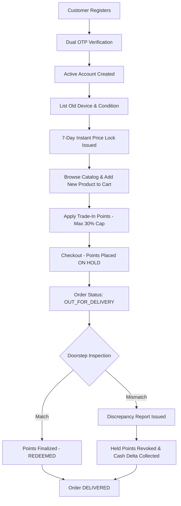

# REVOLT: App Flow & State Machine Document

## 1. End-to-End Customer Flow

## 2. Order Lifecycle State Machine
- `PLACED`: Order registered; trade-in points placed ON_HOLD in ledger.
- `CONFIRMED`: Warehouse inventory reserved.
- `PACKED`: Shipment packaged with tracking tag.
- `SHIPPED`: In-transit to regional hub.
- `OUT_FOR_DELIVERY`: Assigned to field agent; 4-digit Handover Secret OTP issued to customer.
- `DELIVERED`: Physical doorstep inspection completed and OTP validated.
- `CANCELLED`: Order aborted; points restored to wallet.
